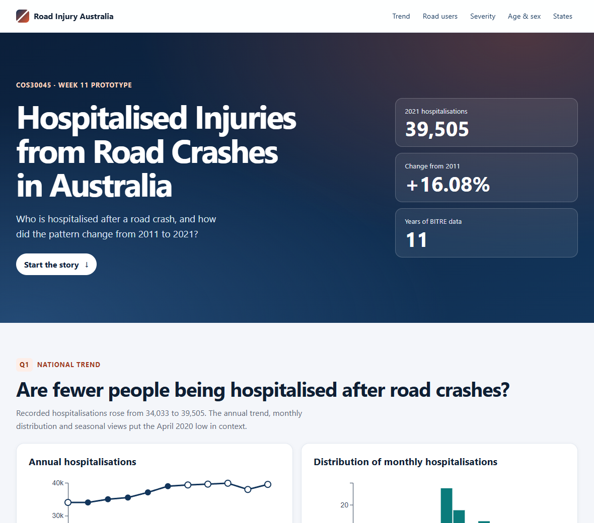
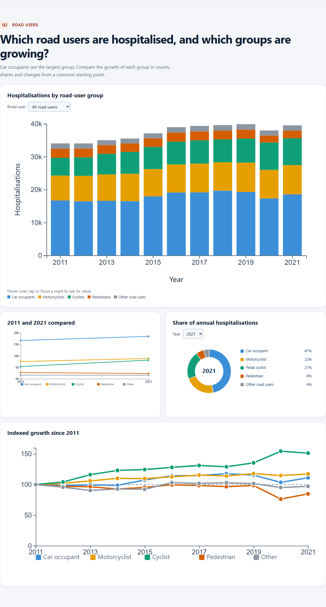
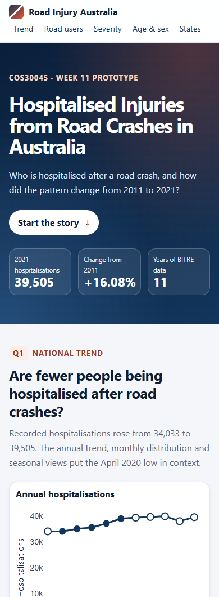

# Week 11 presentation and Q&A

COS30045 Data Visualisation · Group 5 · Team member 1 · Design draft

**Hospitalised injuries from road crashes in Australia, 2011–2021** · [Open the interactive prototype](https://buidangminh23.github.io/cos30045-road-crash-injuries/)

## Visualisation Design

The story starts with the national pattern, then moves through road users, length of stay, age and recorded sex, and state of residence. BITRE recorded 34,033 traffic hospitalisations in 2011 and 39,505 in 2021, a rise of 16.08%. The figures are recorded hospitalisations. Assessing risk would require population or exposure data.

| Question | Colour chart prototypes | Main encoding and rationale |
| --- | --- | --- |
| **Q1. Has the number changed?** | Annual line, monthly histogram, month-by-year heatmap, monthly anomaly columns. | Position shows the annual trend and the distribution of monthly counts. Heatmap intensity shows seasonality. Diverging columns show the direction and size of each 2020–2021 month's departure from the same-month 2017–2019 average. |
| **Q2. Which groups drive the change?** | Stacked counts, endpoint slope chart, share donut, indexed lines. | Use one categorical colour per road-user group throughout. The stack shows growth and composition. Endpoint slope and indexed lines make differing growth rates easier to compare. The donut answers the share question for one year at a time. |
| **Q3. Who stays longest?** | Severity scatter, ranked lollipop, case-share versus bed-day-share dumbbell. | The scatter contrasts the number of hospitalisations with average stay. Hollow marks flag estimates based on fewer than 1,000 cases. Sorted positions make length of stay comparable. On the dumbbell, the gap exposes cases where a group's share of bed days exceeds its share of cases. |
| **Q4. How do age and recorded sex shape who is hurt?** | Age pyramid, grouped bars with measure switch, sex-ratio chart. | The pyramid shows the profile on either side of a common centre. Grouped bars compare two values from the same baseline within each age group. The ratio shows the gap directly, using parity as a reference. |
| **Q5. How do state trends differ?** | State lines, diverging state-change bars, First Nations area, state contribution waterfall. | Position and line weight help readers follow one state in the trend view. Diverging bars separate increases and decreases. The waterfall adds the contributions into a single net change. The area shows recorded First Nations counts alongside the recording caveat. |

Use a zero baseline for count and grouped bars. Label the waterfall's truncated scale. Label axes, units, groups and recording changes. Keep the national line navy, use orange for emphasis, and use blue, amber, teal, vermilion and slate to distinguish road-user categories. Support colour with legends and mark shape. Bar and divergence directions also communicate meaning.

## Interaction Design

Readers start with the overview and go straight to the comparison they need. Focused marks expose exact values and caveats. The prototype lets users try the planned high-value controls without navigating away from the story.

| Control | Planned response |
| --- | --- |
| Question links | Jump to one of the five questions and retain the reading order within it. |
| Road-user dropdown | Switch the stack between all groups and one group's yearly counts. The scale keeps zero and updates for the selected scope. |
| Donut year | Switch between 2011 and 2021. Keep colours tied to the same categories. |
| Age and sex controls | Switch the y-axis and bars between hospitalisations and bed days per case. The sex control filters the visible bars while preserving comparability within the selected measure. |
| State dropdown | Switch from the state overview to the selected state and make small series easier to see. |
| Data marks | Provide details through hover or keyboard focus. Include units and relevant recording caveats. |

## Website Design

A persistent desktop navigation bar sits above a navy hero with headline figures. The five question sections use orange accents and white chart cards on a light canvas. Primary comparisons appear first, followed by supporting chart cards. Short introductions explain what to look for before each group of charts. The source and limits of the data sit after the five questions.

On phones, the links wrap and the charts stack into one column. Keep the filter labels beside their controls and keep details underneath the relevant chart. Use a consistent layout so users can move from the national story to a state comparison without learning a new page structure.

## Prototype and sketches

The [coded prototype](https://buidangminh23.github.io/cos30045-road-crash-injuries/) shows the latest design across all five questions. It draws the charts from aggregate CSVs, with no image dependency for the working views.

## Plan for coding

### Data to load

Load the aggregate BITRE CSVs with `d3.csv`, convert numeric fields, and parse recording flags explicitly. Keep a single source of truth for group order, colours and units. Reuse the same rows across related charts.

| CSV | Expected rows | Charts and fields |
| --- | ---: | --- |
| `c1_national_by_year.csv` | 11 | Annual line. Use year, hospitalisations and series-break flag. |
| `c1b_national_by_month.csv` | 132 | Histogram, heatmap and anomalies. Use year, month number and hospitalisations. Calculate the 2017–2019 baseline separately for each month. |
| `c2_road_user_group_by_year.csv` | 55 | Stack, slope, donut and index. Use year, group, count, national total and share. Index each group to its own 2011 count. |
| `c3_road_user_severity_2016_2021.csv` | 12 | Scatter, lollipop and dumbbell. Use road-user category, group, hospitalisations, cases, bed days and days per case. Aggregate by road-user group and compute shares from the same total. |
| `c4_age_sex.csv` | 14 | Pyramid, grouped bars and ratio. Use age order, recorded sex, hospitalisations and days per case. |
| `c5_state_by_year.csv` | 88 | Lines, change bars and waterfall. Use state, year, count and series-break flag. Compute changes from each state's 2011 count. |
| `c5b_first_nations_by_year.csv` | 11 | First Nations area. Use year and count, with the status-not-stated figures for context. |

### Coding tasks

1. Build the semantic layout, question navigation and responsive chart cards in `index.html` and `prototype/styles.css`.
2. Draw the six core comparisons and wire the road-user, measure, sex and state controls in `prototype/charts.js`. Build the twelve supporting previews and donut year switch in `prototype/previews.js`.
3. For the final implementation, consolidate shared margins, dimensions, palette, formats, road-user order, the 1,000-case threshold and the 5.23-day all-traffic reference. Share CSV reads, chart details and error states across the chart modules.
4. Reconcile annual totals and group shares, check the sign of changes and test every selector, pointer and keyboard interaction at desktop and mobile widths.

Data source: [BITRE Hospitalised Injury Data](https://www.bitre.gov.au/publications/ongoing/hospitalised-injury).
