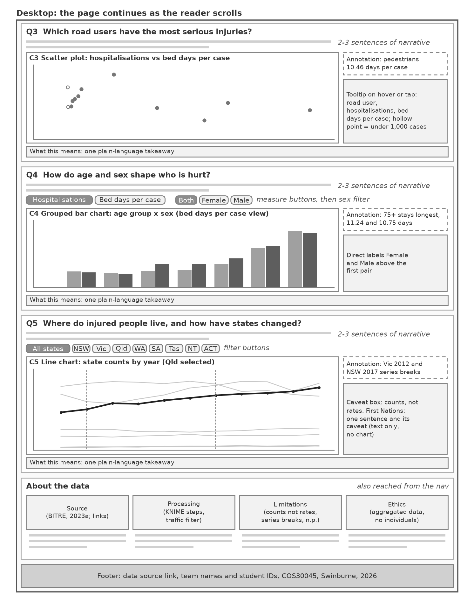
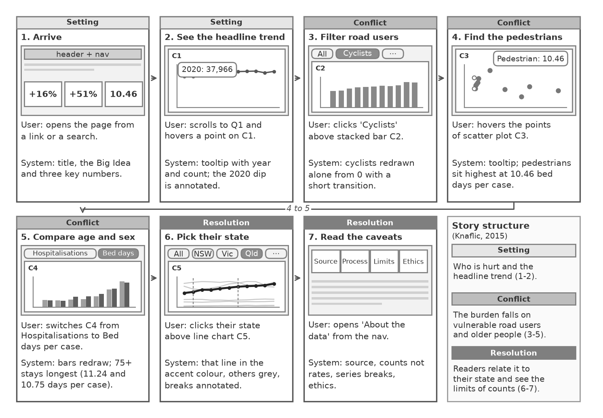
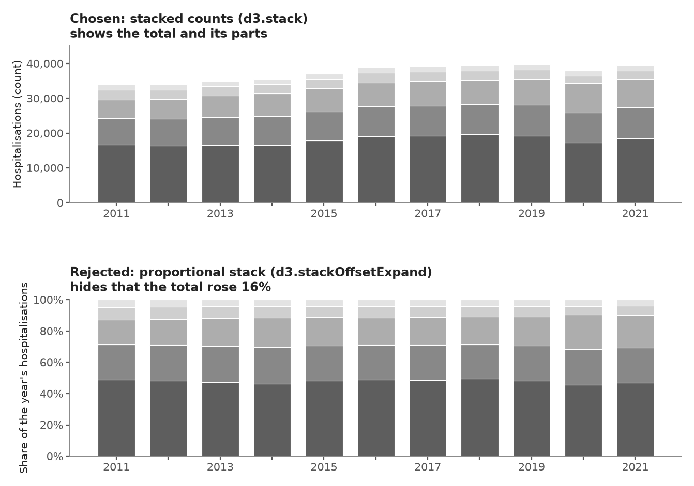
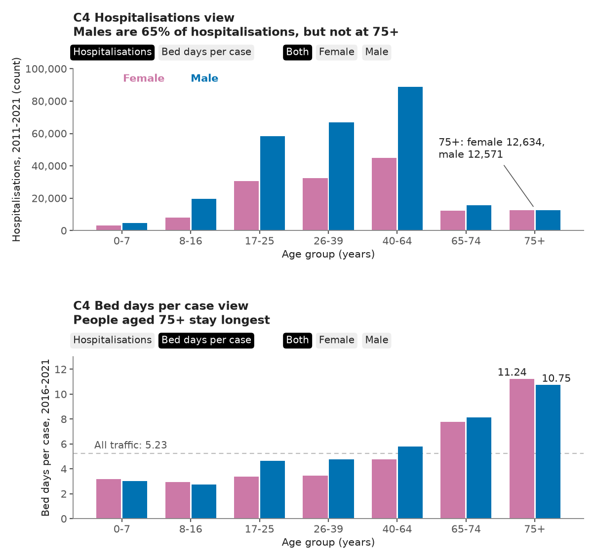
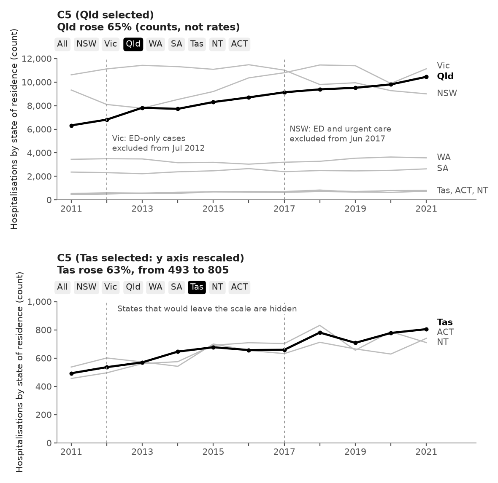
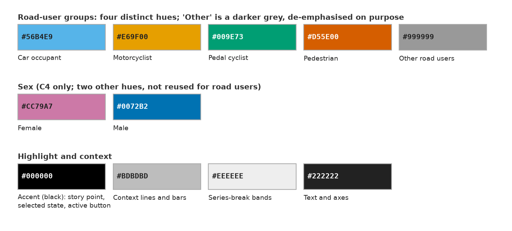

# Week 11 presentation and Q&A

COS30045 Data Visualisation · Group 5 · Team member 1 · Design draft

**Hospitalised injuries from road crashes in Australia, 2011–2021**

## Visualisation Design

The story is for general readers interested in road safety. It starts with the national trend, then compares road users, injury severity, age and sex, and state of residence. BITRE recorded 34,033 traffic hospitalisations in 2011 and 39,505 in 2021, an increase of 16.08%. Counts describe recorded hospitalisations. Population and exposure data would be needed to compare risks.

| Question | Planned chart and encoding | Design rationale |
| --- | --- | --- |
| **Q1. How did hospitalisations change?** | **C1** line chart with years on x and annual counts on y. **C1b** histogram of the 132 monthly counts with 100-hospitalisation bins. | The line preserves chronological order and makes the 2020 dip visible. The histogram shows how unusual April 2020 was within the distribution. Label recording changes on C1 and highlight the lowest bin in C1b. |
| **Q2. Which road users are hospitalised most, and which groups are growing?** | **C2** stacked bars by year. Segment length shows count and hue identifies the road-user group. Put car occupants at the bottom and label groups directly. | The count stack shows the change in the overall total and its composition. A 100% stack, considered in the sketches, shows share but makes every yearly total look equal. Use tooltips for share and let readers isolate any group on a common zero baseline. |
| **Q3. Which road users have longer hospital stays?** | **C3** scatter plot of hospitalisations versus bed days per case, with one point per road-user category. Use hollow circles below 1,000 cases and a dashed all-traffic reference at 5.23 days. | Position on two labelled scales shows frequency alongside average stay. Equal-size points keep attention on the two variables. Label pedestrians and use the hollow symbol to flag estimates based on few cases. Length of stay is a proxy for severity. |
| **Q4. How do age and recorded sex shape who is hurt?** | **C4** side-by-side bars in natural age order, with separate bars for each recorded sex. Switch between hospitalisations and bed days per case. | The shared baseline supports comparisons within each age group. Annotate the similar counts in the 75+ group in the first view and the longer stays in the second. State the date range in each view. |
| **Q5. How do trends differ by state of residence?** | **C5** line chart with year on x and hospitalisations on y. Emphasise a selected state with stroke weight and points. Annotate the 2012 Victoria and 2017 NSW recording changes. | A focus line over grey context is easier to follow than eight bright lines. A single-state view helps readers inspect smaller series. Keep the First Nations counts in accompanying text with the caveat about changes in the reporting of Indigenous status. |

Give bars a zero baseline, show units on every axis and use direct labels or a key for categories. Draw recording-change markers as annotations so readers can distinguish those changes from changes in injuries. Reuse the road-user colours in C2 and C3. Pair colour with bar position, labels, outline and line weight. Check text and mark contrast against the page background and test the palette for colour-vision deficiencies.

## Interaction Design

Readers first see the overall trend or comparison, then narrow it with the controls attached to that question. Exact values and caveats are available on demand. C1, C1b and C3 need detail tooltips alone because their main findings are visible in the default view. The annual series fits on one axis, so there is no planned time zoom or brushing.

| View | Reader action | Planned response |
| --- | --- | --- |
| C1 and C1b | Hover, tap or focus a year or bin | Show the year and count plus the relevant break note, or the bin bounds and number of months. Name April 2020 in the lowest bin. |
| C2 | Choose All road users or one group | Draw the stack or selected series. Keep the selected group's colour and show the change to the zero-based y scale. On a segment, show the year, group, count and annual share. |
| C3 | Hover, tap or focus a point | Show road user, hospitalisations and bed days per case. Explain the hollow marker when the group has fewer than 1,000 cases. |
| C4 | Choose a measure and optionally filter by recorded sex | Update title, units and bars for the measure. Keep the same y scale for Both, Female and Male within each measure. Show both measures in a bar tooltip. |
| C5 | Choose All or a state, then inspect a year | Highlight the selected state and show the other lines in grey where they fit. Start its adjusted y scale at zero. Show the count, change from 2011 and any recording note. |

Use native buttons with visible focus and an announced pressed state. The same detail should be available through pointer hover, tap and keyboard focus. Let readers dismiss tooltips by moving focus, pressing Escape or tapping outside the mark. Brief transitions will connect old and new scales and marks after filter changes, with a reduced-motion option.

## Website Design

Use a single scrolling page with a header, question links, introduction, five story sections, conclusion, data notes and footer. Start with the main finding and the headline counts. Each question follows the same reading order: question, short explanation, controls if needed, figure and takeaway. The story moves from the national trend to groups and severity, then to a state the reader recognises. Close with data coverage, sources and the limits of comparing counts.

The desktop wireframe puts C1 and C1b side by side. On small screens the page becomes one column, the charts stack, controls wrap, and annotations or keys sit below the figure if they would crowd it. Plan a compact question menu with keyboard access and keep chart text legible at 360 px.

## Prototype and sketches

### Page layout and reader journey

### Chart sketches

## Plan for coding

### Data to load

Load the planned KNIME CSV exports with `d3.csv` and a row converter for each schema. Convert year, measures and sort fields to numbers, parse the series-break flag explicitly, and keep category labels as strings. Check the required columns before rendering. Give an affected section an error or empty-state message while the other sections render.

| Export | Expected rows | Fields used and destination |
| --- | ---: | --- |
| `c1_national_by_year.csv` | 11 | Year, hospitalisations and series-break flag for C1. |
| `c1b_national_by_month.csv` | 132 | Year, month and hospitalisations for C1b. Bin counts are calculated in D3. |
| `c2_road_user_group_by_year.csv` | 55 | Year, group, group order, count, national total and share for C2. Group the rows by year before stacking. |
| `c3_road_user_severity_2016_2021.csv` | 12 | Road-user label and group, hospitalisations, cases and bed days per case for C3. |
| `c4_age_sex.csv` | 14 | Age group and order, recorded sex, 2011–2021 hospitalisations and 2016–2021 bed days per case for C4. |
| `c5_state_by_year.csv` | 88 | Year, state code and name, count and series-break flag for C5. Keep the 2011 count of each state for comparisons. |
| `c5b_first_nations_by_year.csv` | 11 | Year, First Nations count and count with status not stated for the Q5 text. |

### Implementation order

1. Build the semantic page skeleton in `index.html` and responsive layout in `css/`. Add a heading, container, source note and textual takeaway for each chart.
2. Put paths and schema conversion in `js/load-data.js`. Add shared chart dimensions (700 × 400 SVG viewBox), default and direct-label margins, group order and colours, integer year ticks, number formats, the 5.23-day reference, the 1,000-case threshold and the 500 ms transition duration in `js/shared-constants.js`.
3. Give each chart a separate module. Use `d3.line` for C1 and C5, `d3.bin` for C1b, `d3.stack` for C2, a circle data join for C3 and grouped band scales for C4. Build axes, labels and caveat annotations before wiring the controls.
4. Share the button and tooltip logic between chart modules. Keep the state of each question local to that question. Handle click, tap and focus with the same displayed values and update the relevant marks, axes and accessible description when the selected view changes.
5. Validate the endpoint counts in C1 against BITRE, check that the C2 groups sum to the annual total and test the C4 measure and sex controls independently. In C5, test a small state and both series-break notes. Check keyboard interaction, small screens and the response when a CSV fails to load.

Draft and sketches adapted from Section 3 of the Group 5 Design Book. Data source: [BITRE Hospitalised Injury Data](https://www.bitre.gov.au/publications/ongoing/hospitalised-injury).
