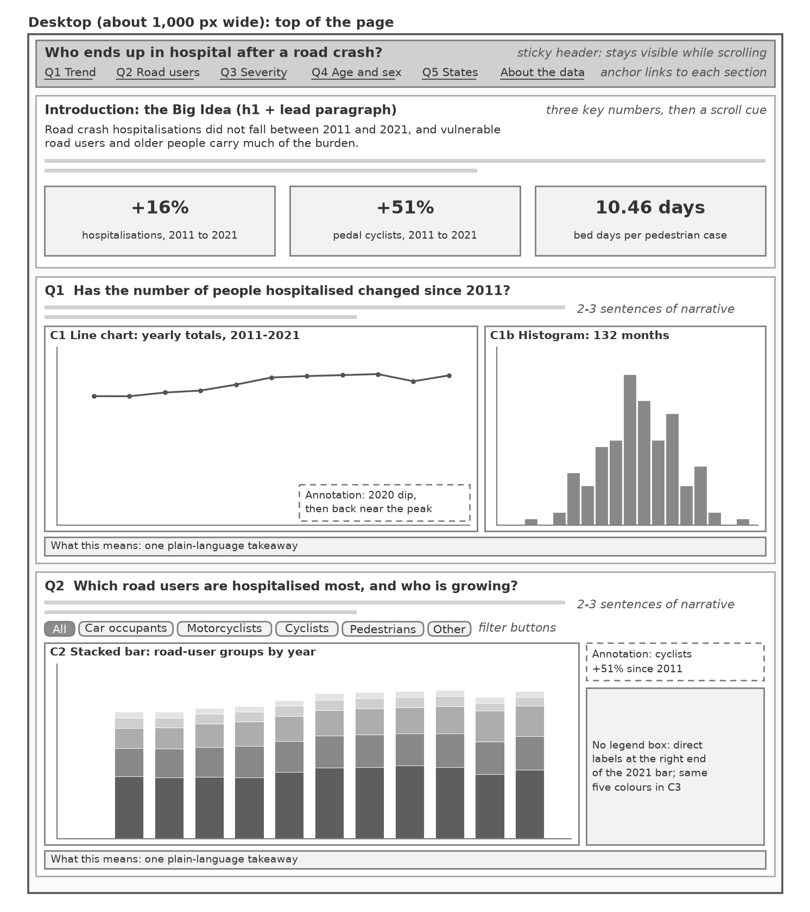
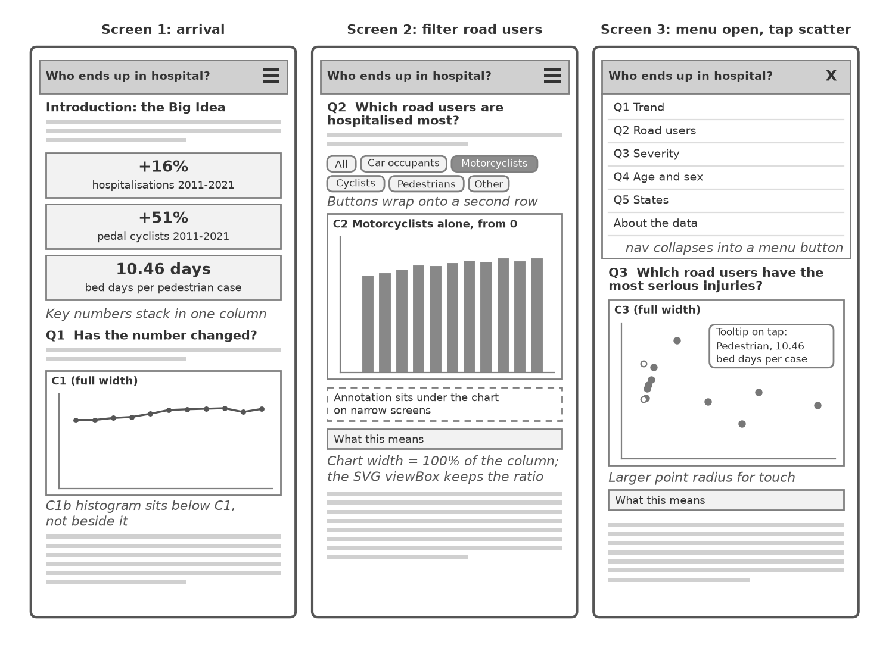
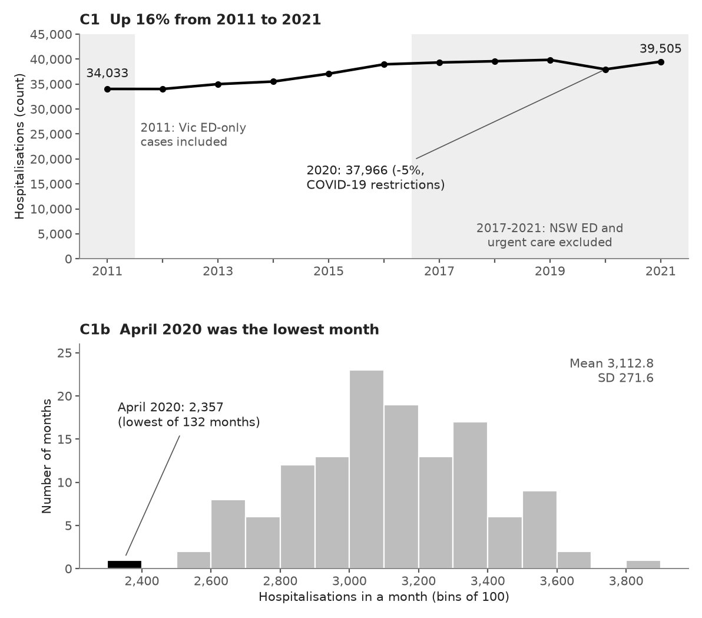
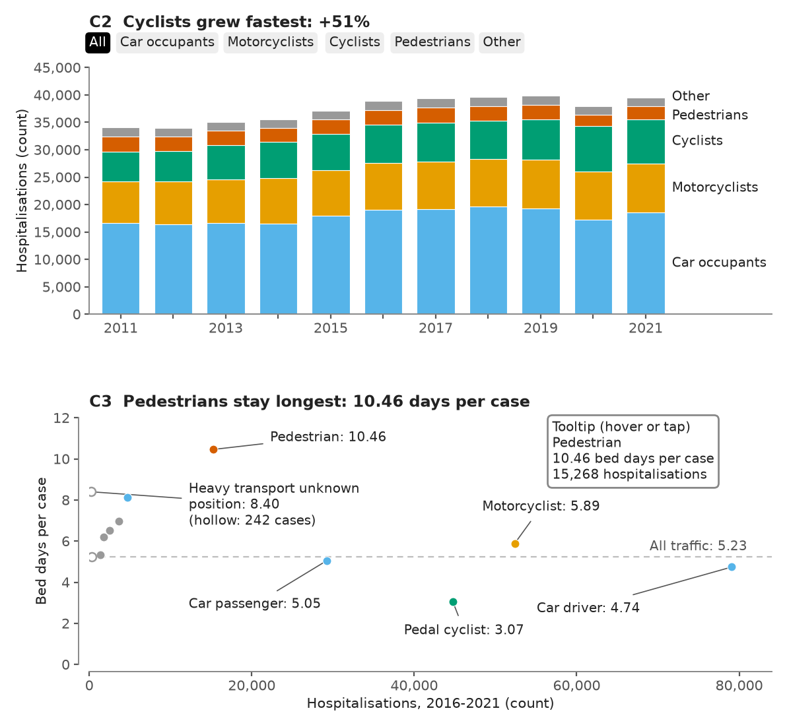

# Who ends up in hospital after a road crash?

COS30045 Data Visualisation · Group 5 · Week 11 stand-up (24 November 2026)

A guided data story on hospitalised injuries from road crashes in Australia, 2011–2021, using the BITRE hospitalised injury data. Road crash hospitalisations rose from 34,033 in 2011 to 39,505 in 2021 (+16%), and injured pedestrians stay about 10.5 days in hospital, twice the 5.2 days for all road users.

## Status at Week 11

| Done | Planned for Week 12 (1 December 2026) |
| --- | --- |
| KNIME workflow (88 nodes) and its eight CSV files in `data/` | Six D3.js charts with interactions |
| Introduction page (`index.html`, `css/base.css`) | Responsive and accessibility features |
| Wireframes, storyboard and chart mock-ups in `figures/design/` | Usability testing |
| Shared constants for the charts in `js/shared-constants.js` | Deployment to the COS30045 Mercury server |

## Planned charts

| Question | Chart | Data file (rows) |
| --- | --- | --- |
| Q1 Has the number changed? | C1 line chart of yearly totals, with grey bands for the 2011 and 2017–2021 recording changes | `c1_national_by_year.csv` (11) |
| Q1 How unusual was 2020? | C1b histogram of 132 monthly counts, April 2020 highlighted | `c1b_national_by_month.csv` (132) |
| Q2 Which road users, and which are growing? | C2 stacked bar chart from a zero baseline, with a button for each road-user group | `c2_road_user_group_by_year.csv` (55) |
| Q3 Which road users have the most serious injuries? | C3 scatter plot of hospitalisations against bed days per case; hollow points below 1,000 cases | `c3_road_user_severity_2016_2021.csv` (12) |
| Q4 How do age and sex shape who is hurt? | C4 grouped bar chart with Hospitalisations / Bed days per case and Both / Female / Male buttons | `c4_age_sex.csv` (14) |
| Q5 Where do injured people live? | C5 state multi-line chart, selected state highlighted, Vic 2012 and NSW 2017 recording changes marked | `c5_state_by_year.csv` (88) |
| Q5 First Nations | Text only, no chart, because recording of Indigenous status changed over the period | `c5b_first_nations_by_year.csv` (11) |

`data/road-user-trend.csv` (143 rows) is also written by the KNIME workflow. It is a compatibility file from an earlier version of the page and is not loaded.

## Coding plan

- Load the seven files once with `Promise.all([d3.csv(...)])`; each row function converts numbers with `+d.value` and the series-break flag with `d.is_series_break === "true"`.
- C1 uses `d3.line`, C1b `d3.bin`, C2 `d3.stack` with `d3.scaleBand`, C4 a nested `d3.scaleBand` with `d3.scaleLinear`, and C5 `d3.group` with `d3.line`. Road-user colours come from one `d3.scaleOrdinal`.
- Buttons use `.on("click")`; tooltips use `.on("mouseenter")` and `.on("mouseleave")`, which also respond to taps; keyboard users get the same tooltip through `.on("focus")`.
- `js/shared-constants.js` holds the Okabe-Ito palette, `MIN_CASES = 1000`, `ALL_TRAFFIC_DAYS = 5.23`, the transition length and the SVG size.

## Palette

| Use | Colour |
| --- | --- |
| Car occupants / Motorcyclists | `#56B4E9` / `#E69F00` |
| Pedal cyclists / Pedestrians | `#009E73` / `#D55E00` |
| Other road users | `#8C8C8C` |
| Female / Male | `#CC79A7` / `#0072B2` |
| Story line and active button / Context grey / Series-break band | `#222222` / `#858585` / `#ECECEC` |

## Sketches

## Run locally

Serve the folder with any static server, for example `npx http-server -p 8080`, and open `http://localhost:8080`.

## Data source

Bureau of Infrastructure and Transport Research Economics. (2023). *Hospitalised injury* [Data set]. https://www.bitre.gov.au/resource/road-safety/hospitalised-injury
